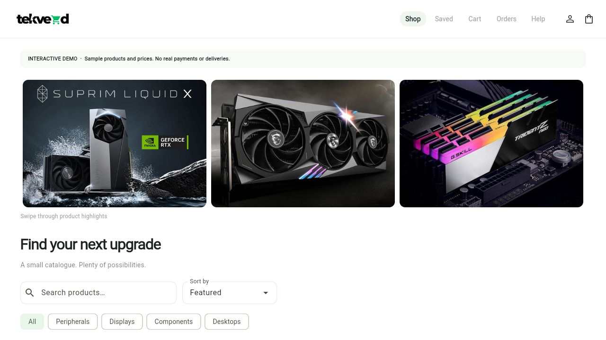
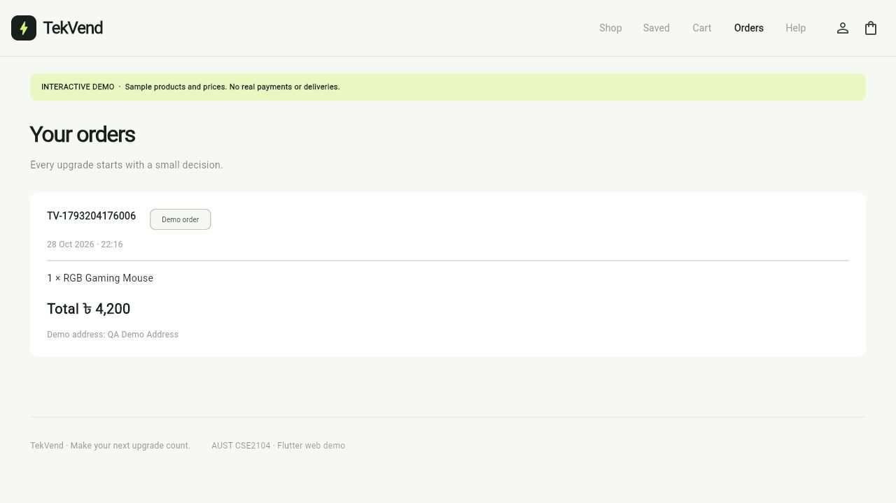

<div align="center">

# TekVend

### Find your next upgrade.

A Flutter electronics marketplace with a persistent interactive web demo and the original Firebase application.

[Live demo](https://tekvend.tahmidkhan.com.bd) · [Source](https://github.com/tahmidkhanshuvo/TekVend) · [Report a problem](https://github.com/tahmidkhanshuvo/TekVend/issues)

   

</div>



<details><summary>View a completed demo order</summary>



</details>

Originally developed by AUST CSE students for **CSE2104**. The complete marketplace source has been retained, including the original Firebase authentication, product, cart and profile screens. The public web experience is a clearly labelled interactive demo using sample catalogue data and local browser persistence. It does not charge money, dispatch products, create a cloud account, or share a cart between devices.

## Explore the web demo

Use **Your profile → Reset local demo** to remove this browser's demo profile, saved products, cart and receipts after trying the app. A confirmation protects against accidental clearing; other browser storage is preserved.

- Browse electronics with product photos, categories, search and sorting.
- Open product details and save favourites.
- Add items to a bounded cart, change quantities and remove products.
- Enter a demo delivery address and complete a simulated checkout.
- Revisit local order receipts, saved items and profile details after reloading.
- Use the responsive layout on desktop or mobile, with labelled controls and built-in help.

Cart changes are persisted through SharedPreferences. Checkout requires an address and records a receipt before clearing the cart. The original Firebase cart also merges by product ID and validates quantities instead of relying on fragile array positions.

## Two application modes

| Mode | Default | Storage and behavior |
| --- | --- | --- |
| Interactive demo | Web | Local SharedPreferences; sample stock/prices; simulated checkout |
| Original application | Android/native | Existing Firebase project, authentication, Firestore/database and storage integration |

Choose explicitly with `--dart-define=DEMO_MODE=true` or `false`. The Dart package name remains `amar` to preserve existing imports; the product name is TekVend. Native Firebase flows require the correct Firebase configuration, enabled providers and security rules. The web demo does not validate or exercise those external services.

## Run locally

Use **Flutter 3.47.8** with **Dart 3.13.7**, the versions used by CI and the deployment script.

```sh
flutter pub get
flutter run -d chrome --dart-define=DEMO_MODE=true
```

For the original app, configure your Firebase project and platform files, then use an Android emulator/device:

```sh
flutter run --dart-define=DEMO_MODE=false
```

Keep service-account keys, signing files and private provider secrets outside Git. Firebase client configuration identifies a project; enforce actual access through Firebase Authentication and database/storage rules. To configure another project, regenerate the platform configuration with the official FlutterFire tooling rather than editing generated identifiers piecemeal.

### Optional original assistant

The native assistant no longer contains a hardcoded provider key. Missing configuration gives a controlled explanation. If you enable that original integration, supply `GEMINI_API_KEY` and a currently supported `GEMINI_MODEL` using `--dart-define`. Client builds can expose embedded keys; use a restricted development credential and a server-side integration before operating a public paid service. Requests time out and return visible errors without leaving the send button stuck. Any historically published key must be revoked at its provider; removing it from current source does not revoke it.

## Repository map

| Path | Purpose |
| --- | --- |
| `lib/main.dart` | Mode selection and application startup |
| `lib/demo/demo_app.dart` | Responsive web storefront and demo interactions |
| `lib/demo/demo_store.dart` | Catalogue, persistence, quantities and simulated receipts |
| `lib/shopping`, `lib/controllers`, `lib/auth screen` | Original application screens and Firebase flows |
| `lib/images` | Original product and visual assets |
| `web` | Web bootstrap, manifest and browser metadata |
| `test/widget_test.dart` | Persistence, checkout and storefront checks |
| `scripts/build-web.sh` | Reproducible pinned Flutter web build |
| `.github/workflows/verify.yml` | Analyzer, tests and release build |

## Verify changes

```sh
flutter analyze --no-fatal-infos
flutter test
flutter build web --release --dart-define=DEMO_MODE=true --no-wasm-dry-run
```

Four tests cover quantity bounds and cart persistence, required checkout address/receipt ordering, saved products/profile persistence, and rendering the storefront without Firebase. The release web build passes. The analyzer reports legacy informational/deprecation notices; there are no analyzer errors or warnings in the verified run. A physical Android device test and production Firebase rules review remain separate platform checks.

## Deployment

The included Vercel configuration uses the **Other** preset, repository root, `bash scripts/build-web.sh`, and output `build/web`. The script obtains Flutter **3.47.8** from its official repository, disables analytics, installs locked dependencies and builds demo mode. It requires no paid service or backend secrets. SPA rewrites preserve direct paths and the bootstrap script is served without stale caching.

After deployment, verify search, product details, saving, cart quantities, address validation, simulated checkout and receipt persistence on desktop and mobile. Browser-local demo data belongs to that origin; changing domains starts a separate local store. Original native Firebase features remain available in their mode and should be tested with the intended project's rules before a native release.
